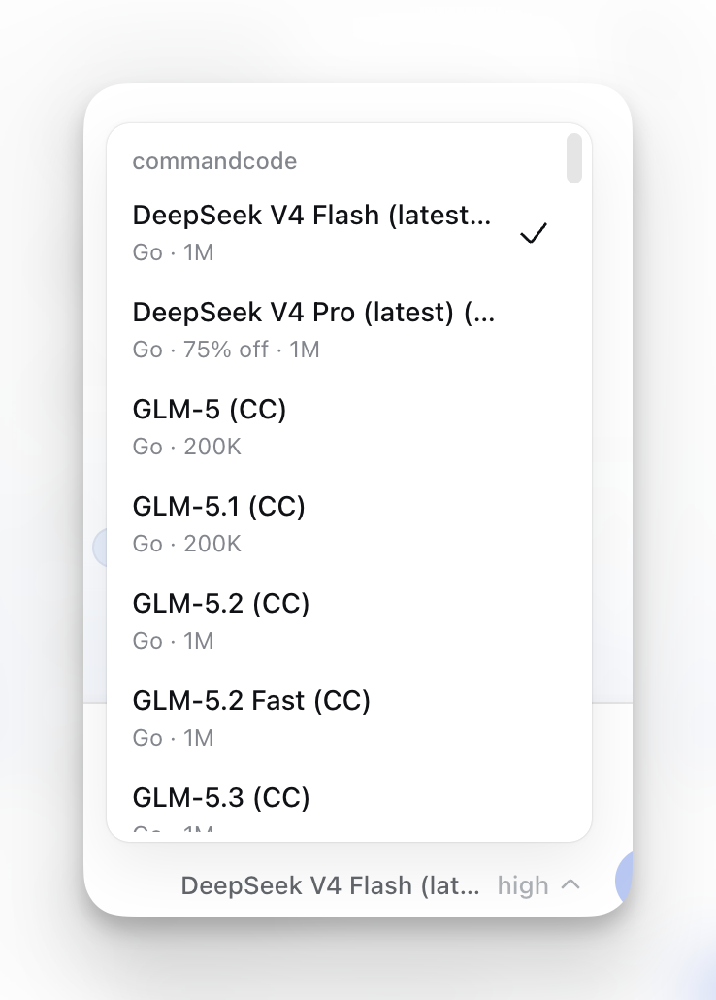
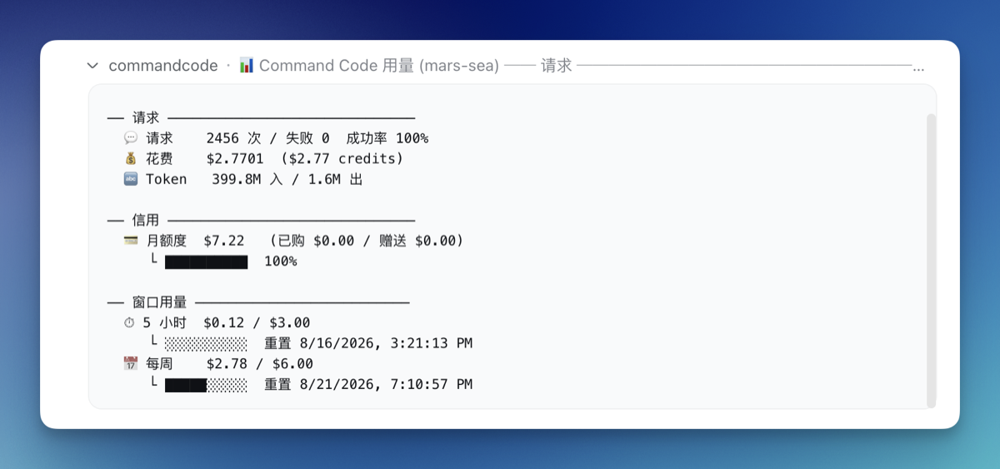
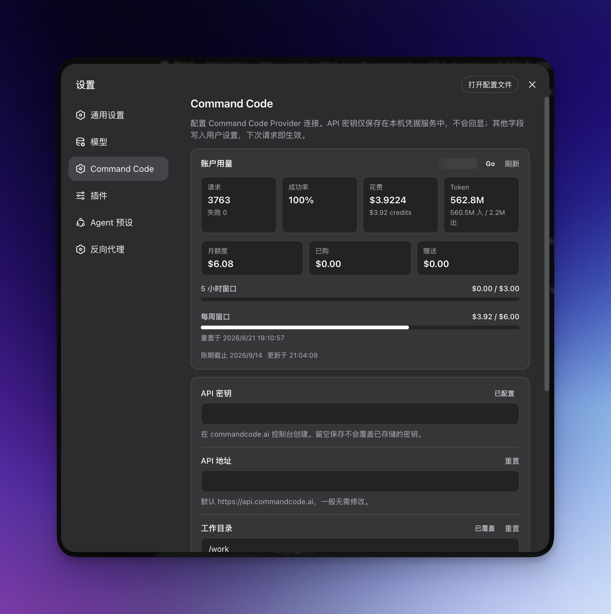

# dsh-commandcode-provider

**English** | [简体中文](./README.zh-CN.md)

[](https://github.com/awesome-dsh-plugin/awesome-dsh-plugin)
[](https://github.com/Mars-Sea/dsh-commandcode-provider/stargazers)
[](https://github.com/deepseek-ai/deepseek-harness)
[](https://github.com/Mars-Sea/dsh-commandcode-provider/pulls)
[](https://github.com/Mars-Sea/dsh-commandcode-provider/actions/workflows/ci.yml)
[](https://opensource.org/licenses/MIT)
[](https://www.npmjs.com/package/@mars-sea/dsh-commandcode-provider)

Unofficial [DeepSeek Harness](https://deepseek-harness.github.io/deepseek-harness/) LLM provider plugin for **Command Code**, ported from [pi-commandcode-provider](https://github.com/patlux/pi-commandcode-provider) (MIT).

> This is a community integration. You need your own Command Code account and API key or subscription, and Command Code's terms apply. This project is not affiliated with Command Code, Inc.

## What you get

- **Plugin bundle** — install into any dsh profile with `dsh plugin add`; registers a `commandcode` provider route with a live model catalog.
- **Dedicated settings page** — one account list (keys, sign-in, live quota, dedicated models), model visibility, privacy switches, and connection options.
- **Model analysis** — open from Settings to inspect tokens, estimated cost, response timing and failures/retries by recent sessions or date range, including closed sessions with inherited fork usage excluded. Compare fixed-workload prices and objective capabilities without automatic recommendations or quality scores. Missing data and scan limits remain visible; complete date ranges can be extrapolated to 30 days. Estimates use current prices and are not invoices. See [scope and limitations](docs/模型成本与性能分析.md).
- **Works in the terminal too** — the same install serves a [dsh-TUI](#terminal-ui-dsh-tui) profile, with its own **`/settings` → Command Code** page for the API key and the model controls.
- **Models-page key card** — the **Settings → Models → Command Code** card carries the key status, a paste field, and the sign-in button inline.
- **In-browser sign-in for keys** — start the official authorization flow (the same one `cmd login` runs) from the settings page; the approved key lands in the local credential service automatically. Manual paste remains the fallback.
- **Multi-account rotation** — when one account hits its usage limit, requests switch to the next account automatically. See [Account rotation](#account-rotation).
- **Flexible API key setup** — via the settings page, an environment variable, or the official CLI login file.
- **Model-picker annotations** — minimum plan, active deal or `FREE` badge, peak/off-peak state, image support, and context window; free models listed first.
- **Custom context length** — override the context window the harness meters and compacts against: one global value plus per-model overrides, edited on the settings page or in config (issue #86); unset follows the catalog.
- **Plan-aware picker** — models above your subscription tier are hidden by default (toggleable); an optional **Model allowlist** keeps only your favorites in the picker.
- **Reasoning-effort support** — models with selectable reasoning effort levels expose them in the picker.
- **Image input** — Vision-capable models accept images.
- **Plans & quota panel** — an optional Command Code card at the bottom of the sidebar (directly above Settings) shows the serving account's plan and its 5-hour and weekly windows; clicking it opens a dashboard with the billing period, both windows as progress bars with reset times, monthly credit consumption, and the purchased/free balances. The dashboard's **×** button hands the center column back to your conversation (the current session is untouched). **Off by default** — turn on *"Show the quota card in the sidebar"* under **Settings → Command Code → Integrations & display** to show it, and the same switch hides it again (a hidden card draws nothing at all and runs no background usage poll); the change lands as soon as you save. The panel follows your harness language (中文 / English).
- **Session cost estimate** — published-rate estimates (`≈`) beside the composer token counter and in its usage dialog, using each request's model, request time and context tier from durable session history. Model switches and viewing the session later do not reprice earlier requests. Mixed-provider or unpriced usage shows a labeled subtotal (`≥`); missing history or wholly unpriceable usage stays hidden. Automatic and manual compaction inside a session sends one extra model request, recorded on the `compaction/summary` event; that usage is now priced into the Command Code cost, and into the historical model analysis, while summaries written by other providers stay unpriced. These are estimates from the installed price snapshot, not provider invoices. Also English on every harness language.
- **Web search** — the dsh `web_search` tool is backed by the Command Code Provider API (`/alpha/web-search`) with the same key/endpoint as chat, so no separate search key or base URL is needed. See [Web search](#web-search).

See [Screenshots](#screenshots) below for what the UI looks like.

## Install

This release supports **dsh 0.2.0-rc.2 and 0.2.1-rc.2 (RC) and dsh 0.2.1-alpha.4
(alpha)**, and stays backwards compatible: the previous stable RC
(`0.2.0-rc.2`, npm's `latest`) is kept alongside the new one (`0.2.1-rc.2`,
npm's `next` on 2026-10-18). The alpha channel keeps the last verified official
alpha release, `0.2.1-alpha.4`; npm's `alpha` tag has since moved to
`0.2.1-alpha.5`, which this build does not claim. The peer range and
compatibility records name exactly these three versions. Note that **dsh
0.2.1-alpha.4 and later read `engines.dsh` alone** when deciding whether a
plugin is compatible; the dsh peer ranges are consulted only when that field is
absent, so a build that declares the wrong `engines.dsh` is refused outright.
Profiles on `0.2.1-alpha.3` or older, or on any engine outside these three,
must upgrade (or stay on plugin 0.13.4) before installing this build:

```sh
dsh plugin --profile web add @mars-sea/dsh-commandcode-provider@latest
```

- **Older dsh releases.** The 0.1.2–0.1.7 line is no longer supported: those
  engines predate the 0.1.7 settings rewrite, the `RequestMessage` envelope, and
  the durable image-offload contract, and the compatibility code that bridged
  the two was removed. The last plugin release covering 0.1.7 is 0.11.17; the
  0.1.2–0.1.6 line's last release is 0.11.11; the 0.5.0-era Harness line's last
  release is 0.9.1. All are installed by exact version and none is maintained:

  ```sh
  dsh plugin --profile web add @mars-sea/dsh-commandcode-provider@0.11.17   # dsh 0.1.7
  dsh plugin --profile web add @mars-sea/dsh-commandcode-provider@0.11.11   # dsh 0.1.2–0.1.6
  dsh plugin --profile web add @mars-sea/dsh-commandcode-provider@0.9.1     # dsh 0.5.0 line
  ```

**pnpm 11 holds back new releases.** Its `minimumReleaseAge` defaults to 1440 minutes, so a version published less than a day ago is skipped and `@latest` resolves to the *previous* release — silently, with a success exit code. To install a release from the last 24 hours, name it exactly:

```sh
dsh plugin --profile web add @mars-sea/dsh-commandcode-provider@0.11.15
```

The same applies to every profile you install into, including the terminal UI below.

Fresh pnpm 10 marketplace generations are supported directly. Every Harness package is declared by the plugin as a Host peer, so the active dsh profile remains their owner; do not add a separate dependency for any of them. The `@deepseek-ai/dsh-*` packages share one exact-version disjunction; `@deepseek-ai/cordis` and `@deepseek-ai/schemastery` carry the paired ranges `~4.0.4 || ~4.0.5-alpha.1` and `~3.18.4 || ~3.18.5-alpha.1` instead, because publishing an engine rewrites both to the version that shipped alongside it. Upstream removed the `@deepseek-ai/dsh-invariants` package in `0.2.1-alpha.1`, so the plugin no longer declares it.

## Updating

Update with the same tag you installed with:

```sh
dsh plugin --profile web update @mars-sea/dsh-commandcode-provider@latest     # dsh 0.2.0-rc.2, 0.2.1-rc.2 or 0.2.1-alpha.4
dsh plugin --profile web update @mars-sea/dsh-commandcode-provider@0.9.1      # older dsh (0.5.0 line, unmaintained)
```

Each profile updates separately — the terminal UI owns its own plugin list (see below):

```sh
dsh plugin --profile dsh-tui update @mars-sea/dsh-commandcode-provider@0.11.15
```

To move to a version published less than 24 hours ago, name it exactly as in Install above; pnpm 11's age gate resolves `@latest` to the previous release instead.

Then restart the web app.

## Getting an API key

The easiest path is the official CLI (Node.js 22+):

```sh
npm i -g command-code@latest
cmd login        # macOS/Linux; native Windows: cmdc login
```

Or skip the CLI: click **Sign in to Command Code** under **Settings → Command Code** — your browser opens the commandcode.ai authorization page (the same flow `cmd login` uses) and the key is stored in the local credential service when you approve. You can still create a key on the [Keys settings page](https://commandcode.ai/mars-sea/settings/keys) and paste it into **Settings → Command Code**, or `export COMMANDCODE_API_KEY="user_..."`.

> The sign-in flow needs the Host and your browser on the same machine (loopback callback). With a remote Host, paste the key manually; a literal composition-level `apiKey`, if set, still takes precedence over a signed-in credential.

## Verify it works

After restart, enter your API key in **Settings → Command Code** and save; **Settings → Models** shows a **Command Code** card, and the model picker lists the live catalog under **commandcode**. Send a message with a model your plan includes.

## Terminal UI (dsh-TUI)

The plugin also works under a terminal front door. **Each dsh profile owns its own plugin list**, so the web install above does not reach the terminal — add the plugin to the `dsh-tui` profile as well:

```sh
dsh plugin --profile dsh-tui add @mars-sea/dsh-commandcode-provider@0.11.15
```

Pin the exact version here. For the first 24 hours after a release, a bare package name (or `@latest`) is silently resolved to the previous one: the install succeeds, but the profile gets the older build — which is how a fresh terminal install ends up with no **`/settings` → Command Code** page and no `commandcode` models at all.

Then pick the provider in the model selector, or name it directly:

```text
/model commandcode/deepseek/deepseek-v4.1-flash
```

`/model` lists every registered provider, with Command Code's live catalog and its plan/deal/context annotations. The `/commandcode` usage dashboard works there too.

**Entering the key.** The TUI has no web Models page, so the plugin declares its own page in the TUI settings screen — **`/settings` → Command Code** — with the API key, the API base, the out-of-plan model filter, the active account, and the command language. The key field is write-only: it shows whether a key is configured and writes what you type to the credential store, never to a settings document. The same page is the only place a TUI-only user needs to visit.

**Picking models.** That page lists the whole catalog as checkboxes, grouped by plan tier (Go → GOAT → Pro → Provider) with the free models first, so nothing has to be typed from memory. Everything starts checked, because an unset allowlist means "show every model" — uncheck the ones you do not want in the picker. The choice is stored as per-model overrides next to the `visibleModels` list the web page edits, so both surfaces can be used interchangeably and a plain `visibleModels` written by hand still works.

Alternatively, set the key outside the TUI. The first match wins:

- A literal `apiKey` written into the composition config wins over everything else and is always used.
- Otherwise the credential reference is resolved (`apiKeyEnv`, `COMMANDCODE_API_KEY` by default). In a profile that **mounts the credentials service** — Web, desktop, SDK, ACP — that service owns the layer order: **from 0.2.1-alpha.3 on, a saved credential wins over the launching environment**, with the environment and `.env` as the fallback; 0.2.1-alpha.2 and earlier were the other way round, with the environment first.
- A **headless profile deliberately mounts no credentials service**, so only the launching environment, the project `.env`, and `$DSH_HOME/.env` apply — **a key saved on the page never reaches a headless run**. Export the variable or write a `.env` for those runs.
- The last resort is `~/.commandcode/auth.json`, written by the official CLI.

```sh
export COMMANDCODE_API_KEY="user_..."   # launching environment
cmd login                               # writes ~/.commandcode/auth.json
```

**Making Command Code the default.** dsh-TUI pins its own agent route, and its `agent-default-model` setting does not override it. To start every session on Command Code, override the `agent-loop` row in your profile patch (`$DSH_HOME/profiles/dsh-tui/cordis.patch.yml`):

```yaml
- id: agent-loop
  inject: [tuiStartup]
  config:
    agents:
      - id: main
        provider: commandcode
        model: deepseek/deepseek-v4.1-flash
        reasoningEffort: max
        cwd: !!js process.cwd()
```

**Engine version.** The plugin is maintained against three engines, backwards compatible: **dsh 0.2.0-rc.2** (the previous stable RC), **dsh 0.2.1-rc.2** and **dsh 0.2.1-alpha.4**. Its `@deepseek-ai/dsh-*` peers use `0.2.0-rc.2 || 0.2.1-rc.2 || 0.2.1-alpha.4`, while `@deepseek-ai/cordis` and `@deepseek-ai/schemastery` retain their engine-paired ranges `~4.0.4 || ~4.0.5-alpha.1` and `~3.18.4 || ~3.18.5-alpha.1` (rc.2 pairs Cordis `4.0.5` and Schemastery `3.18.5`, which those ranges already admit, so they do not move). Compatibility records contain exactly these three engines. A new engine is admitted only after a full real-engine matrix run on it; the previous stable RC is retained rather than dropped, so an engine upgrade is not forced on existing users. Unverified neighbours are never admitted. Both `npm run test:engine` and `npm run test:install` check each retained version, and `test:engine` also calls that engine's own `evaluatePluginCompatibility` on the published manifest — from alpha.4 on, that verdict reads `engines.dsh` alone, so a wrong engine declaration fails there instead of only at install time. See [Install](#install) for older engines.

## Usage dashboard

The plugin registers a `/commandcode` slash command showing per-account usage:

```text
/commandcode        (or /commandcode status)
```

The command's user-facing copy follows the shell's locale: explicit `lang: 'en' | 'zh'` in the `llm-commandcode` plugin config wins, otherwise `LC_ALL`/`LANG` is read, otherwise it falls back to `zh`. The web settings page is independent — it follows the browser's language preference on its own.

## Account rotation

With several Command Code subscriptions, the plugin **switches to the next account automatically** when one hits its usage limit:

- **Setup** — click **Add account** in the **Accounts** card at Settings → **Command Code**, optionally name it, then either **Sign in to Command Code** (the key is stored when you approve in the browser; a sign-in that does not complete leaves no empty account behind) or paste an API key. Account actions — add, rename, replace or clear a key, remove, pin — apply immediately; only the other settings on the page wait for the Save bar. The top-level key always serves first as the `default` account.
- **Manual switching** — **Pin this account** in an account's **⋯** menu makes it the preferred account; if it is exhausted, requests fall back to other accounts and return once its window resets. **Unpin** returns to automatic rotation.
- **Dedicated models** — expand an account and pick its **Dedicated models** from the live catalog. A request for one of those models serves from that account while it is usable; an exhausted or invalid account falls back to the normal rotation. A model belongs to one account at a time — picking it for another account moves it. (Stored as `modelAccountRules`.)
- **Show only favorite models** — the **Visible models** picker in the **Models & context** card keeps only the checked models in the model picker; unchecked shows all (the default).
- **Status** — each account row shows its plan, status and 5-hour/weekly meters; expand it for the full report. `/commandcode` reports the same per-account state.

The equivalent YAML (`$DSH_HOME/settings.yaml` or composition config):

```yaml
llm-commandcode:
  apiKeyEnv: COMMANDCODE_API_KEY        # first (default) account
  activeAccount: COMMANDCODE_API_KEY_2   # optional: pin the active account (`default` or an account's credential ref)
  accounts:                              # rotation order after it
    - label: Go #2
      apiKeyEnv: COMMANDCODE_API_KEY_2
    - label: Go #3
      apiKeyEnv: COMMANDCODE_API_KEY_3
  modelAccountRules:                     # optional: route models to accounts (first match wins)
    - models:                            # catalog model ids (multi-select)
        - deepseek/deepseek-v4-pro
        - deepseek/deepseek-v4-flash-vision-exp
      account: COMMANDCODE_API_KEY_2
    - models:
        - tencent/hy4-preview
      account: default
  visibleModels:                       # optional: show only these models in pickers (catalog model ids); unset shows all
    - deepseek/deepseek-v4-pro
    - tencent/hy4-preview
```

## Configure

**Settings → Command Code** is organized as **Accounts** (keys, sign-in, live quota, pinning, dedicated models), **Models & context** (hide out-of-plan models, visible models, then the **Custom context length** field and the **Per-model overrides** rows right after the allowlist — global and per model, see below), **Privacy & security** (zero data retention, off by default, see below), **Integrations & display** (serve web search with Command Code, show the quota card in the sidebar, off by default), and a collapsed **Advanced** section (API base URL, request/stream timeouts, transport retries, cache-aware image offload). The working directory is no longer on the page; `workingDir` in config still works.

The same options live in `$DSH_HOME/settings.yaml` (changes apply immediately, no restart):

```yaml
llm-commandcode:
  apiKeyEnv: COMMANDCODE_API_KEY   # credential reference
  apiBase: https://api.commandcode.ai
  workingDir: /path/to/project     # optional
  modelsCachePath: ~/.commandcode/models-cache.json
  requestTimeoutMs: 300000          # default 300s (the official CLI's own budget)
  streamIdleTimeoutMs: 300000      # default 300s
  # offloadSeenImagesForCache: true # opt in to CLI cache mitigation; later requests omit old pixels
  showSidebarQuota: true           # optional: show the plans & quota card in the sidebar (default off)
  zdr: true                        # optional: route requests only through zero-data-retention upstreams (default off)
  # contextWindow: 131072          # optional: custom context length (tokens) for every model; unset follows the catalog
  # contextWindowOverrides:        # optional: per-model custom context lengths; wins over contextWindow
  #   deepseek/deepseek-v4-pro: 65536
  # maxOutputTokens: 65536         # optional: per-turn output limit; 0 sends no max_tokens, unset follows the model ceiling
```

### Custom context length

The context window the harness meters against — and when it compacts — normally comes from the model catalog's `context_length`. The opt-in **Custom context length** field and **Per-model overrides** rows inside **Settings → Command Code → Models & context**, directly after the visible-models allowlist (or the two config fields above, issue #86), replace it per your own numbers: `contextWindow` is the global custom value applied to every model without its own row, and `contextWindowOverrides` sets one model by catalog id, winning over the global value. Unset follows the catalog; nothing changes by default.

- **When it helps**: a catalog window that over-reports turns into `context_length_exceeded` failures once a session grows past the model's real capacity — advertise the lower real number and the harness compacts before the gateway refuses. An under-reported window makes long sessions compact earlier than they need to; raise it to match the model's true capacity.
- The model-picker context annotation, `defaultMaxTokens` default and actual requests follow the same resolution. Raising the window removes the old catalog-window output cap while retaining the model's independent output ceiling, runtime-learned ceiling and gateway-wide cap; explicit output counts obey those caps too. Session-cost tier pricing keeps using each request's actual token counts.
- Values must be whole token counts in 1 – 10,000,000. The page blocks invalid input; config-file non-numbers, fractions and out-of-range values fail schema validation rather than silently falling back. Only programmatic calls that bypass the schema discard invalid values and fall through valid per-model override → valid global value → catalog. A model the catalog does not list keeps its "no context advertised" shape.
- The inputs accept compact shorthand in binary units: `32K` = 32,768 and `1M` = 1,048,576 (so `128K`/`256K` write the exact power-of-two windows 131,072/262,144); the stored value is always a plain number. The per-model override's model dropdown lists only the models kept by the **visible-models allowlist** (the whole catalog while showing all), and the rows carry "Model / Context length" column heads.

### Per-turn output limit

Every request carries `max_tokens`, resolved as the smallest of the model's published output ceiling, the ceiling learned at runtime, and the gateway-wide cap of 131,072. That field is a **passive hard limit**: the platform cuts the answer when it is reached, and the model receives no "nearly out of room" signal. The **Output limit per turn** field (**Settings → Command Code → Models & context**, or the `maxOutputTokens` config key) offers three choices:

- **Empty (default)**: exactly the derivation above, so nothing changes.
- **A positive number**: taken as a cap alongside that derived value. It can only **tighten** — it never exceeds the model ceiling or the gateway's `131072`, and out-of-range input fails config validation. Shorthand like `64K` is accepted.
- **`0`**: sends **no** `max_tokens` field at all, leaving the per-turn output size to the platform. This is the fix for answers being cut off mid-sentence, because while the field is present the cut happens at some point no matter how large the figure is.

`0` only takes effect on the two transports that accept an absent field: the CLI (`/alpha/generate`) and OpenAI (`/provider/v1/chat/completions`). The Anthropic Messages endpoint Claude uses **requires** the field — omitting it is refused upstream with `Invalid input: expected number, received undefined at max_tokens` — so that route keeps sending its derived budget and `0` has no effect for Claude. Auxiliary calls whose budget the host fixes itself (the session title is pinned at 64 tokens) also outrank this setting and are not unbound by `0`.

An empty field **clears** the setting back to the derived default; it is not the same as writing `0`.

### Repeated image cache misses

On the CLI transport (`/alpha/generate`), a new image can make Command Code's reported prompt cache retreat to the first historical image even when every previous request message is byte-identical. The opt-in **Stop replaying images already seen** setting (`offloadSeenImagesForCache`) asks dsh's durable `image/offload` surface to replace an older image with a stable text placeholder after this same model has answered with it. The next request keeps its new image; later text can be cached without replaying old pixels. The default is off because the model cannot inspect an offloaded image again unless it rereads the source file or the user reattaches it. This mitigates the observed cost spike; it does not repair Command Code's underlying multimodal cache behavior. [Live evidence and limits](docs/issue-64-cache-review.md).

## Web search

When your deployment's dsh shell mounts the web capability (`@deepseek-ai/dsh-web` + `@deepseek-ai/dsh-tool-web`), the model's `web_search` tool is served by this plugin's `commandcode` search provider — it calls the Command Code Provider API's `/alpha/web-search` endpoint with the **same API key and base URL** as chat. You do not configure a separate search key, endpoint, or model.

**On by default.** The plugin's **Settings → Command Code** page has a *"Serve dsh web search with Command Code"* toggle (`webSearch`, default on). When on, the plugin selects `commandcode` as the active search backend automatically; turn it off to hand the selection back to whichever backend was there before (a sibling search plugin such as modsearch keeps working — it is never forced back to dsh's shipped DeepSeek search). The toggle takes effect on the next search — no restart needed.

- The provider registers as `commandcode` on `ctx.web` only when the web service is present; without it this stays a chat-only plugin.
- The toggle works by selecting `commandcode` in the web seam at boot and on every settings change, remembering the backend it displaced; turning the toggle off (or unloading the plugin) restores that backend. If you'd rather pin it durably, set `searchProvider: commandcode` (or `$DSH_WEB_SEARCH_PROVIDER=commandcode`); that remains effective even if this plugin's runtime selection is unavailable.
- `numResults` from the dsh tool is clamped to the Command Code range (1–10, default 5); results map to the dsh `WebSearchSource` shape (`url`/`title`/`snippet`).

> This reuses the Command Code Provider API directly (like the official CLI's built-in `web_search`), so it is distinct from a DeepSeek-native search backend.

## Zero data retention (ZDR)

Command Code can serve a request only through upstreams that retain no prompts or completions and never train on them — the same opt-in the official CLI exposes as `CMD_ZDR=1`, and the `x-cmd-zdr: 1` header on the Provider API ([official docs](https://commandcode.ai/docs/resources/zdr)).

**Off by default.** Turn it on with the *"Zero data retention (ZDR)"* toggle (`zdr`) in the Privacy & security card, or in your profile config. How this plugin implements it:

- The header is sent on **every chat request** while ZDR is on. The plugin maintains an informational exception list (`KNOWN_NON_ZDR_MODELS`, synced from the official CLI — 22 models as of 2026-10-14, e.g. `xai/grok-4.5`, `stealth/glyph-cluster:free`, `stepfun/Step-3.7-Flash`, `meta/muse-wonder-1.0`). A model without an available ZDR upstream fails with `422 cmd_zdr_no_providers`; the request is never retried without the header.
- If a refusal still happens (coverage churn, or no ZDR upstream with spare capacity at that moment), the error names the cause and how to turn ZDR off, instead of surfacing as a bare HTTP 422.
- **ZDR usually costs more**: capacity is limited and billed at each upstream's pass-through rates, and which upstream serves a request can change per request. The session-cost readout keeps quoting the ordinary catalog rates; the real per-request price shows in Command Code's Studio usage page.
- Works on every plan; plan credits meter ZDR requests at the plan's default allowance.

## Notes & limitations

- **Image input is model-gated** — only Vision models accept images; text-only models refuse them.
- **Image size is reported as sent** — the adapter overrides `imageRequestTarget` with the target this route actually puts on the wire: long edge 1568, encoded bytes capped at 1 MiB. The harness's screenshot callers therefore size against what the gateway receives instead of the normalized original.
- Switching to a text-only model in an image-bearing session is rejected by dsh — pick a model marked *`Image`* or remove the images first.
- **Long image-heavy sessions keep working** — the provider caps the size of a single request (around 50 MB, and it is undocumented), so a session that accumulates many screenshots would otherwise start failing every request once it grew past that. The oldest images beyond the budget are replaced by a short "image omitted" note that names the attachment, the newest ones are sent as usual, and a request the provider still rejects as too large is retried once with a much smaller image budget before failing.
- **No `stop` sequences** — requests carrying one fail.
- Historical reasoning is replayed on both transports so a tool-calling loop keeps its chain of thought: `/provider/v1/chat/completions` passes it back as `reasoning_content`, and `/alpha/generate` carries it as a `reasoning` block inside the rebuilt assistant turn (the shape the official CLI sends) — a DeepSeek thinking-mode tool loop is rejected without it. Only tool calls with a paired tool result are replayed on either transport.
- Every tool's parameter schema is normalized to the object root the provider requires, so a tool declared without one (a third-party plugin's hand-written schema, an MCP server's own `inputSchema`, a generated root `$ref`) no longer fails the whole turn with `schema must be a JSON Schema of 'type: "object"'`.
- The model catalog is browsable without a key; chat requests need one.

## Permissions & privacy

The plugin only communicates between your local dsh profile and your Command Code account: locally it touches only the credential store and the models cache (plus `~/.commandcode/auth.json` as a last-resort fallback); on the network it calls only the Command Code API. No telemetry. With **zero data retention** on (also off by default), chat requests require a ZDR upstream; models without one fail instead of running without the protection.

## Disabling / uninstalling

- **Disable** without removing: edit your profile's `cordis.patch.yml` and comment out (or remove) the `llm-commandcode` row, or set `disabled: true`, then restart.
- **Uninstall** completely:

  ```sh
  dsh plugin --profile web remove @mars-sea/dsh-commandcode-provider
  ```

  Your API key in the dsh credential store and `~/.commandcode/auth.json` are left untouched.

## Development

```sh
npm install
npm run typecheck   # tsc --noEmit
npm run build       # tsdown -> lib/
```

To try a local build in a profile:

```sh
dsh plugin --profile web add /path/to/dsh-commandcode-provider
```

After changing `src/`, re-run `npm run build` and restart the app.

## Community & feedback

-  [GitHub Repository](https://github.com/Mars-Sea/dsh-commandcode-provider)
-  [GitHub Releases](https://github.com/Mars-Sea/dsh-commandcode-provider/releases)
-  [npm Package](https://www.npmjs.com/package/@mars-sea/dsh-commandcode-provider)
-  [Linux.do 社区](https://linux.do/)

## License

MIT — see [LICENSE](./LICENSE). Portions ported from [pi-commandcode-provider](https://github.com/patlux/pi-commandcode-provider) (MIT).

## Screenshots

**Model picker** — plan tier, deal/FREE, peak/off-peak, Image and context annotations:



**Usage dashboard** — `/commandcode` per-account report:



**Settings page** — the account list with live quota, model visibility, privacy switches and connection options:



### Package entry points

The package exports the plugin root, `/client`, `/locale/*.json`, and `/package.json`. Source remains in the repository; the unpackaged `./src/*` export was removed. `npm run test:pack` checks declared entry points against the actual packed file list.
